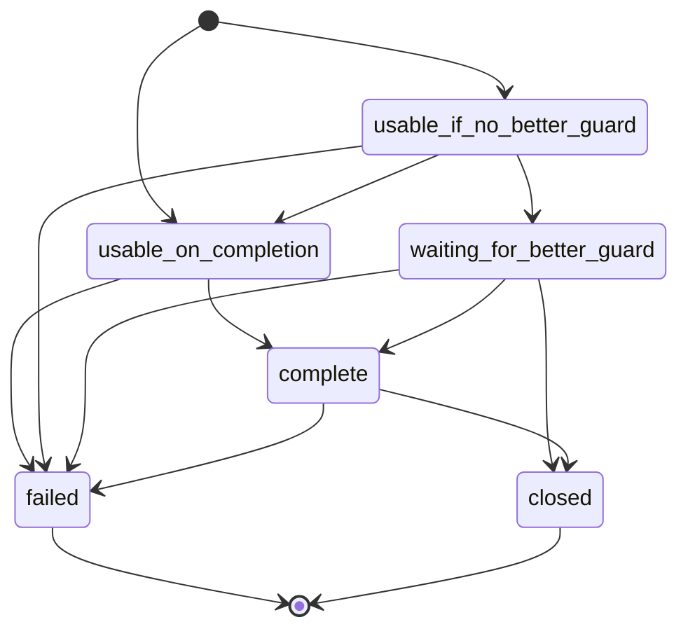

<a id="guard-spec.txt-4"></a>

# The algorithm

<a id="guard-spec.txt-4.0"></a>

## The guards listed in the current consensus. {#GUARDS}

By {set:GUARDS} we mean the set of all guards in the current
consensus that are usable for all circuits and directory
requests. (They must have the flags: Stable, Fast, V2Dir, Guard.)

**Rationale**

We require all guards to have the flags that we potentially need
from any guard, so that all guards are usable for all circuits.

<a id="guard-spec.txt-4.1"></a>

## The Sampled Guard Set. {#SAMPLED}

We maintain a set, {set:SAMPLED_GUARDS}, that persists across
invocations of Tor. It is a subset of the nodes ordered by a sample idx that
we have seen listed as a guard in the consensus at some point.
For each such guard, we record persistently:

```text
      - {pvar:ADDED_ON_DATE}: The date on which it was added to
        sampled_guards.

        We set this value to a point in the past, using
        RAND(now, {GUARD_LIFETIME}/10). See
        Appendix [RANDOM] below.

      - {pvar:ADDED_BY_VERSION}: The version of Tor that added it to
        sampled_guards.

      - {pvar:IS_LISTED}: Whether it was listed as a usable Guard in
        the _most recent_ consensus we have seen.

      - {pvar:FIRST_UNLISTED_AT}: If IS_LISTED is false, the publication date
        of the earliest consensus in which this guard was listed such that we
        have not seen it listed in any later consensus.  Otherwise "None."
        We randomize this to a point in the past, based on
          RAND(added_at_time, {REMOVE_UNLISTED_GUARDS_AFTER} / 5)
```

For each guard in {SAMPLED_GUARDS}, we also record this data,
non-persistently:

```text
      - {tvar:last_tried_connect}: A 'last tried to connect at'
        time.  Default 'never'.

      - {tvar:is_reachable}: an "is reachable" tristate, with
        possible values { <state:yes>, <state:no>, <state:maybe> }.
        Default '<maybe>.'

               [Note: "yes" is not strictly necessary, but I'm
                making it distinct from "maybe" anyway, to make our
                logic clearer.  A guard is "maybe" reachable if it's
                worth trying. A guard is "yes" reachable if we tried
                it and succeeded.]

               [Note 2: This variable is, in fact, a combination
               of different context-sensitive variables depending
               on the _purpose_ for which we are selecting a guard.
               When we are selecing a guard for an ordinary
               circuit, we look at the regular {is_reachable}.
               But when we are selecting the guard for a one-hop
               directory circuit, we also look at an instance
	       of {is_reachable} that tracks whether
	       downloads of the types we are making have failed
	       recently.]

      - {tvar:failing_since}: The first time when we failed to
        connect to this guard. Defaults to "never".  Reset to
        "never" when we successfully connect to this guard.

      - {tvar:is_pending} A "pending" flag.  This indicates that we
        are trying to build an exploratory circuit through the
        guard, and we don't know whether it will succeed.

      - {tvar:pending_since}: A timestamp.  Set whenever we set
        {tvar:is_pending} to true; cleared whenever we set
        {tvar:is_pending} to false. NOTE
```

We require that {SAMPLED_GUARDS} contain at least
{MIN_FILTERED_SAMPLE} guards from the consensus (if possible),
but not more than {MAX_SAMPLE_THRESHOLD} of the number of guards
in the consensus, and not more than {MAX_SAMPLE_SIZE} in total.
(But if the maximum would be smaller than {MIN_FILTERED_SAMPLE}, we
set the maximum at {MIN_FILTERED_SAMPLE}.)

To add a new guard to {SAMPLED_GUARDS}, pick an entry at random from
({GUARDS} - {SAMPLED_GUARDS}), according to the path selection rules.

We remove an entry from {SAMPLED_GUARDS} if:

```text
      * We have a live consensus, and {IS_LISTED} is false, and
        {FIRST_UNLISTED_AT} is over {REMOVE_UNLISTED_GUARDS_AFTER}
        days in the past.

     OR

      * We have a live consensus, and {CONFIRMED_ON_DATE} is set (not
        "never") and is over {GUARD_CONFIRMED_MIN_LIFETIME} ago.

     OR

      * We have a live consensus, and {CONFIRMED_ON_DATE} is "never",
        and {ADDED_ON_DATE} is over {GUARD_LIFETIME} ago.
```

Note that {SAMPLED_GUARDS} does not depend on our configuration.
It is possible that we can't actually connect to any of these
guards.

**Rationale**

The {SAMPLED_GUARDS} set is meant to limit the total number of
guards that a client will connect to in a given period.  The
upper limit on its size prevents us from considering too many
guards.

The first expiration mechanism is there so that our
{SAMPLED_GUARDS} list does not accumulate so many dead
guards that we cannot add new ones.

The second expiration mechanism makes us rotate our guards slowly
over time.

Ordering the {SAMPLED_GUARDS} set in the order in which we sampled those
guards and picking guards from that set according to this ordering improves
load-balancing. It is closer to offer the expected usage of the guard nodes
as per the path selection rules.

The ordering also improves on another objective of this proposal: trying to
resist an adversary pushing clients over compromised guards, since the
adversary would need the clients to exhaust all their initial
{SAMPLED_GUARDS} set before having a chance to use a newly deployed
adversary node.

<a id="guard-spec.txt-4.2"></a>

## The Usable Sample {#FILTERED}

We maintain another set, {set:FILTERED_GUARDS}, that does not
persist. It is derived from:

```text
       - {SAMPLED_GUARDS}
       - our current configuration,
       - the path bias information.
```

A guard is a member of {set:FILTERED_GUARDS} if and only if all
of the following are true:

```text
       - It is a member of {SAMPLED_GUARDS}, with {IS_LISTED} set to
         true.
       - It is not disabled because of path bias issues.
       - It is not disabled because of ReachableAddresses policy,
         the ClientUseIPv4 setting, the ClientUseIPv6 setting,
         the FascistFirewall setting, or some other
         option that prevents using some addresses.
       - It is not disabled because of ExcludeNodes.
       - It is a bridge if UseBridges is true; or it is not a
         bridge if UseBridges is false.
       - Is included in EntryNodes if EntryNodes is set and
         UseBridges is not. (But see 2.B above).
```

We have an additional subset, {set:USABLE_FILTERED_GUARDS}, which
is defined to be the subset of {FILTERED_GUARDS} where
{is_reachable} is `<yes>` or `<maybe>`.

We try to maintain a requirement that {USABLE_FILTERED_GUARDS}
contain at least {MIN_FILTERED_SAMPLE} elements:

```text
     Whenever we are going to sample from {USABLE_FILTERED_GUARDS},
     and it contains fewer than {MIN_FILTERED_SAMPLE} elements, we
     add new elements to {SAMPLED_GUARDS} until one of the following
     is true:

       * {USABLE_FILTERED_GUARDS} is large enough,
     OR
       * {SAMPLED_GUARDS} is at its maximum size.

     ** Rationale **
```

These filters are applied _after_ sampling: if we applied them
before the sampling, then our sample would reflect the set of
filtering restrictions that we had in the past.

<a id="guard-spec.txt-4.3"></a>

## The confirmed-guard list. {#CONFIRMED}

\[formerly USED_GUARDS\]

We maintain a persistent ordered list, {list:CONFIRMED_GUARDS}.
It contains guards that we have used before, in our preference
order of using them.  It is a subset of {SAMPLED_GUARDS}.  For
each guard in this list, we store persistently:

- {pvar:IDENTITY} Its fingerprint.

```text
      - {pvar:CONFIRMED_ON_DATE} When we added this guard to
        {CONFIRMED_GUARDS}.

        Randomized to a point in the past as RAND(now, {GUARD_LIFETIME}/10).
```

We append new members to {CONFIRMED_GUARDS} when we mark a circuit
built through a guard as "for user traffic."

Whenever we remove a member from {SAMPLED_GUARDS}, we also remove
it from {CONFIRMED_GUARDS}.

```text
      [Note: You can also regard the {CONFIRMED_GUARDS} list as a
      total ordering defined over a subset of {SAMPLED_GUARDS}.]
```

Definition: we call Guard A "higher priority" than another Guard B
if, when A and B are both reachable, we would rather use A.  We
define priority as follows:

```text
     * Every guard in {CONFIRMED_GUARDS} has a higher priority
       than every guard not in {CONFIRMED_GUARDS}.

     * Among guards in {CONFIRMED_GUARDS}, the one appearing earlier
       on the {CONFIRMED_GUARDS} list has a higher priority.

     * Among guards that do not appear in {CONFIRMED_GUARDS},
       {is_pending}==true guards have higher priority.

     * Among those, the guard with earlier {last_tried_connect} time
       has higher priority.

     * Finally, among guards that do not appear in
       {CONFIRMED_GUARDS} with {is_pending==false}, all have equal
       priority.

   ** Rationale **
```

We add elements to this ordering when we have actually used them
for building a usable circuit.  We could mark them at some other
time (such as when we attempt to connect to them, or when we
actually connect to them), but this approach keeps us from
committing to a guard before we actually use it for sensitive
traffic.

<a id="guard-spec.txt-4.4"></a>

## The Primary guards {#PRIMARY}

We keep a run-time non-persistent ordered list of
{list:PRIMARY_GUARDS}.  It is a subset of {FILTERED_GUARDS}.  It
contains {N_PRIMARY_GUARDS} elements.

To compute primary guards, take the ordered intersection of
{CONFIRMED_GUARDS} and {FILTERED_GUARDS}, and take the first
{N_PRIMARY_GUARDS} elements.  If there are fewer than
{N_PRIMARY_GUARDS} elements, append additional elements to
PRIMARY_GUARDS chosen from ({FILTERED_GUARDS} - {CONFIRMED_GUARDS}),
ordered in "sample order" (that is, by {ADDED_ON_DATE}).

Once an element has been added to {PRIMARY_GUARDS}, we do not remove it
until it is replaced by some element from {CONFIRMED_GUARDS}.
That is: if a non-primary guard becomes confirmed and not every primary
guard is confirmed, then the list of primary guards list is regenerated,
first from the confirmed guards (as before), and then from any
non-confirmed primary guards.

Note that {PRIMARY_GUARDS} do not have to be in
{USABLE_FILTERED_GUARDS}: they might be unreachable.

**Rationale**

These guards are treated differently from other guards.  If one of
them is usable, then we use it right away. For other guards
{FILTERED_GUARDS}, if it's usable, then before using it we might
first double-check whether perhaps one of the primary guards is
usable after all.

<a id="guard-spec.txt-4.5"></a>

## Retrying guards. {#RETRYING}

(We run this process as frequently as needed. It can be done once
a second, or just-in-time.)

If a primary sampled guard's {is_reachable} status is `<no>`, then
we decide whether to update its {is_reachable} status to `<maybe>`
based on its {last_tried_connect} time, its {failing_since} time,
and the {PRIMARY_GUARDS_RETRY_SCHED} schedule.

If a non-primary sampled guard's {is_reachable} status is `<no>`, then
we decide whether to update its {is_reachable} status to `<maybe>`
based on its {last_tried_connect} time, its {failing_since} time,
and the {GUARDS_RETRY_SCHED} schedule.

**Rationale**

An observation that a guard has been 'unreachable' only lasts for
a given amount of time, since we can't infer that it's unreachable
now from the fact that it was unreachable a few minutes ago.

## Circuit status {#CIRC-STATUS}

Sometimes the guard selection algorithm will return a guard that we
would always be happy to use; but in other cases, the guard
selection algorithm can return a guard that we shouldn't use
without gathering additional information.

From the point of view of guard selection,
every circuit we build is considered to be in one of these states:

 * `<state:usable_on_completion>`
 * `<state:usable_if_no_better_guard>`
 * `<state:waiting_for_better_guard>`
 * `<state:complete>`

You may only attach streams to `<complete>` circuits.
(Additionally, you may only send RENDEZVOUS messages, ESTABLISH_INTRO
messages, and INTRODUCE messages on `<complete>` circuits.)

The per-circuit state machine is:

 * New circuits are `<usable_on_completion>` or
   `<usable_if_no_better_guard>`.

 * A `<usable_on_completion>` circuit may become `<complete>`, or may
   fail.

 * A `<usable_if_no_better_guard>` circuit may become
   `<usable_on_completion>`; may become `<waiting_for_better_guard>`; or may
   fail.

 * A `<waiting_for_better_guard>` circuit will become `<complete>`, or will
   be closed, or will fail.

 * A `<complete>` circuit remains `<complete>` until it fails or is
   closed.


<!-- TODO: The above diagram does not yet render. Fix that. -->

Each of these transitions is described in sections below.

<a id="guard-spec.txt-4.6"></a>

## Selecting guards for circuits. \[Section:SELECTING\] {#SELECTING}

Now that we have described the various lists of guards, we can explain how
guards are chosen for each circuit.

We keep, as global transient state:

 * {tvar:last_time_on_internet} -- the last time at which we
   successfully used a circuit or connected to a guard.  At
   startup we set this to "infinitely far in the past."

As an input to the algorithm, we take a list of _restrictions_.
These may include specific relays or families that we need to avoid.

Here is the algorithm.  It is given as a series of sub-algorithms,
in decreasing order of preference from best case to worst case.
When we want to build a circuit, and we need to pick a guard:

 * In the base case, if any entry in PRIMARY_GUARDS has {is_reachable} status of
   `<maybe>` or `<yes>`, consider only such guards.  Call them the
   "reachable primary guards".

   Start by considering the the first {NUM_USABLE_PRIMARY_GUARDS} (or
   {NUM_USABLE_PRIMARY_DIRECTORY_GUARDS}) reachable primary guards.
   Remove any guards that do not follow our path selection
   restrictions, to build a temporary list. If that temporary list contains at
   least one guard, choose a guard from that list uniformly at
   random.

   If the temporary list contains no guards, return the first guard
   from our reachable primary guard that does obey the path restriction.

   When selecting a guard according to this approach, its circuit
   is `<usable_on_completion>`.

   \[Note: We do not use {is_pending} on primary guards, since we
   are willing to try to build multiple circuits through them
   before we know for sure whether they work, and since we will
   not use any non-primary guards until we are sure that the
   primary guards are all down.  (XX is this good?)\]

 * Otherwise, if the ordered intersection of {CONFIRMED_GUARDS}
   and {USABLE_FILTERED_GUARDS} is nonempty, return the first
   entry in that intersection that has {is_pending} set to
   false. Set its value of {is_pending} to true,
   and set its {pending_since} to the current time.
   The circuit
   is now `<usable_if_no_better_guard>`.  (If all entries have
   {is_pending} true, pick the first one.)

 * Otherwise, if there is no such entry, select a member from
   {USABLE_FILTERED_GUARDS} in sample order. Set its {is_pending} field to
   true, and set its {pending_since} to the current time.
   The circuit is `<usable_if_no_better_guard>`.

 * Otherwise, in the worst case, if USABLE_FILTERED_GUARDS is empty, we have exhausted
   all the sampled guards.  In this case we proceed by marking all guards
   as `<maybe>` reachable so that we can keep on trying circuits.

Whenever we select a guard for a new circuit attempt, we update the
{last_tried_connect} time for the guard to 'now.'

In some cases (for example, when we need a certain directory feature,
or when we need to avoid using a certain exit as a guard), we need to
restrict the guards that we use for a single circuit. When this happens, we
remember the restrictions that applied when choosing the guard for
that circuit, since we will need them later (see \[UPDATE_WAITING\].).

**Rationale**

We're getting to the core of the algorithm here.  Our main goals are to
make sure that

 1. If it's possible to use a primary guard, we do.
 2. We probably use the first primary guard.

So we only try non-primary guards if we're pretty sure that all
the primary guards are down, and we only try a given primary guard
if the earlier primary guards seem down.

When we _do_ try non-primary guards, however, we only build one
circuit through each, to give it a chance to succeed or fail.  If
ever such a circuit succeeds, we don't use it until we're pretty
sure that it's the best guard we're getting. (see below).

\[XXX timeout.\]

<a id="guard-spec.txt-4.7"></a>

## When a circuit fails. {#ON_FAIL}

When a circuit fails in a way that makes us conclude that a guard
is not reachable, we take the following steps:

```text
      * Set the guard's {is_reachable} status to <no>.  If it had
        {is_pending} set to true, we make it non-pending and clear
        {pending_since}.

      * Close the circuit, of course.  (This removes it from
        consideration by the algorithm in [UPDATE_WAITING].)

      * Update the list of waiting circuits.  (See [UPDATE_WAITING]
        below.)
```

\[Note: the existing Tor logic will cause us to create more
circuits in response to some of these steps; and also see
\[ON_CONSENSUS\].\]

\[Note 2: In the case of a one-hop circuit made for a directory
request, it is possible for the request to fail _after_ the circuit
is built: for example, if we ask for the latest consensus and we are
told "404". In this case, we mark the appropriate directory-specific
`{is_reachable}` instance for that guard to `<no>`.\]

> C tor implements the above "note 2" by treating requests for
> directory guards for as if they had an
> extra type of restriction, rather than a separate instance of
> `{is_reachable}`.  (For more on restrictions, see ["Selecting
> Guards"](#SELECTING) above.)  This requires the C tor
> impementation to special-case this restriction type, so that
> it is treated the same way as an `{is_reachable}` variable.


**Rationale**

See \[SELECTING\] above for rationale.

<a id="guard-spec.txt-4.8"></a>

## When a circuit succeeds {#ON_SUCCESS}

When a circuit succeeds in a way that makes us conclude that a
guard _was_ reachable, we take these steps:

```text
      * We set its {is_reachable} status to <yes>.
      * We set its {failing_since} to "never".
      * If the guard was {is_pending}, we clear the {is_pending} flag
        and set {pending_since} to false.
      * If the guard was not a member of {CONFIRMED_GUARDS}, we add
        it to the end of {CONFIRMED_GUARDS}.

      * If this circuit was <usable_on_completion>, this circuit is
        now <complete>. You may attach streams to this circuit,
        and use it for hidden services.

      * If this circuit was <usable_if_no_better_guard>, it is now
        <waiting_for_better_guard>.  You may not yet attach streams to it.
        Then check whether the {last_time_on_internet} is more than
        {INTERNET_LIKELY_DOWN_INTERVAL} seconds ago:

           * If it is, then mark all {PRIMARY_GUARDS} as "maybe"
             reachable.

           * If it is not, update the list of waiting circuits. (See
             [UPDATE_WAITING] below)
```

\[Note: the existing Tor logic will cause us to create more
circuits in response to some of these steps; and see
\[ON_CONSENSUS\].\]

**Rationale**

See \[SELECTING\] above for rationale.

<a id="guard-spec.txt-4.9"></a>

## Updating the list of waiting circuits {#UPDATE_WAITING}

We run this procedure whenever it's possible that a
`<waiting_for_better_guard>` circuit might be ready to be called
`<complete>`.

```text
   * If any circuit C1 is <waiting_for_better_guard>, AND:
       * All primary guards have reachable status of <no>.
       * There is no circuit C2 that "blocks" C1.
     Then, upgrade C1 to <complete>.

   Definition: In the algorithm above, C2 "blocks" C1 if:
       * C2 obeys all the restrictions that C1 had to obey, AND
       * C2 has higher priority than C1, AND
       * Either C2 is <complete>, or C2 is <waiting_for_better_guard>,
         or C2 has been <usable_if_no_better_guard> for no more than
         {NONPRIMARY_GUARD_CONNECT_TIMEOUT} seconds.

   We run this procedure periodically:

   * If any circuit stays in <waiting_for_better_guard>
     for more than {NONPRIMARY_GUARD_IDLE_TIMEOUT} seconds,
     time it out.

      **Rationale**
```

If we open a connection to a guard, we might want to use it
immediately (if we're sure that it's the best we can do), or we
might want to wait a little while to see if some other circuit
which we like better will finish.

When we mark a circuit `<complete>`, we don't close the
lower-priority circuits immediately: we might decide to use
them after all if the `<complete>` circuit goes down before
{NONPRIMARY_GUARD_IDLE_TIMEOUT} seconds.

<a id="guard-spec.txt-4.9.1"></a>

### Without a list of waiting circuits {#NO_CIRCLIST}

As an alternative to the section \[SECTION:UPDATE_WAITING\] above,
this section presents a new way to maintain guard status
independently of tracking individual circuit status.  This
formulation gives a result equivalent or similar to the approach
above, but simplifies the necessary communications between the
guard and circuit subsystems.

As before, when all primary guards are Unreachable, we need to
try non-primary guards.  We select the first such guard (in
preference order) that is neither Unreachable nor Pending.
Whenever we give out such a guard, if the guard's status is
Unknown, then we call that guard "Pending" with its {is_pending}
flag, until the attempt to use it succeeds or fails.  We remember
when the guard became Pending with the {pending_since variable}.

After completing a circuit, the implementation must check whether
its guard is usable.  A guard's usability status may be "usable",
"unusable", or "unknown".  A guard is usable according to
these rules:

1. Primary guards are always usable.

1. Non-primary guards are usable _for a given circuit_ if every
   guard earlier in the preference list is either unsuitable for
   that circuit (e.g. because of family restrictions), or marked as
   Unreachable, or has been pending for at least
   `{NONPRIMARY_GUARD_CONNECT_TIMEOUT}`.

   Non-primary guards are not usable _for a given circuit_ if some
   guard earlier in the preference list is suitable for the circuit
   _and_ Reachable.

   Non-primary guards are unusable if they have not become
   usable after `{NONPRIMARY_GUARD_IDLE_TIMEOUT}` seconds.

1. If a circuit's guard is not usable or unusable immediately, the
   circuit is not discarded; instead, it is kept (but not used) until the
   guard becomes usable or unusable.

<a id="guard-spec.txt-4.10"></a>

## Whenever we get a new consensus. {#ON_CONSENSUS}

We update {GUARDS}.

For every guard in {SAMPLED_GUARDS}, we update {IS_LISTED} and
{FIRST_UNLISTED_AT}.

\[\*\*\] We remove entries from {SAMPLED_GUARDS} if appropriate,
according to the sampled-guards expiration rules.  If they were
in {CONFIRMED_GUARDS}, we also remove them from
{CONFIRMED_GUARDS}.

We recompute {FILTERED_GUARDS}, and everything that derives from
it, including {USABLE_FILTERED_GUARDS}, and {PRIMARY_GUARDS}.

(Whenever one of the configuration options that affects the
filter is updated, we repeat the process above, starting at the
\[\*\*\] line.)

```text
4.11. Deciding whether to generate a new circuit.
  [Section:NEW_CIRCUIT_NEEDED]
```

We generate a new circuit when we don't have
enough circuits either built or in-progress to handle a given
stream, or an expected stream.

For the purpose of this rule, we say that `<waiting_for_better_guard>`
circuits are neither built nor in-progress; that `<complete>`
circuits are built; and that the other states are in-progress.

```text
4.12. When we are missing descriptors.
   [Section:MISSING_DESCRIPTORS]
```

We need either a router descriptor or a microdescriptor in order
to build a circuit through a guard.  If we do not have such a
descriptor for a guard, we can still use the guard for one-hop
directory fetches, but not for longer circuits.

(Also, when we are missing descriptors for our first
{NUM_USABLE_PRIMARY_GUARDS} primary guards, we don't build
circuits at all until we have fetched them.)
